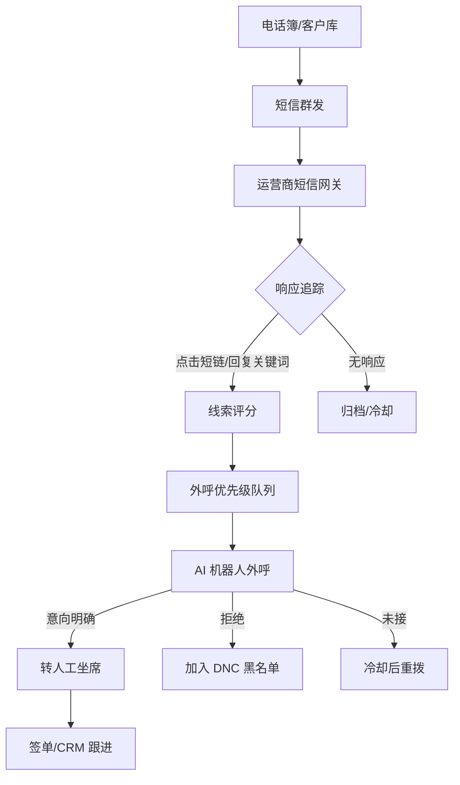
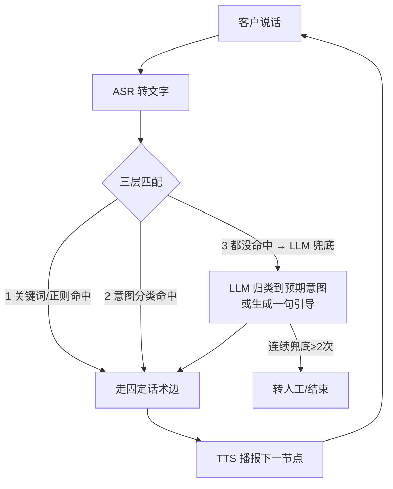

# 贷款外呼系统 · 完整设计稿

> 短信群发 → 线索评分筛优质客户 → AI 机器人外呼(**固定话术为主干 + LLM 兜底**)→ 有意向转人工

---

## 一、完整链路设计



**五段流程**:①群发触达 → ②响应追踪打分 → ③优先级排队 → ④机器人外呼(话术树+LLM兜底)→ ⑤意向转人工。

---

## 二、系统分层与技术选型

| 层 | 职责 | 技术 |
|----|------|------|
| 数据/线索层 | 客户库、评分、任务、通话记录、黑名单 | MySQL + Redis |
| 短信群发层 | 批量发送 + 回执追踪 | 阿里云短信 / 腾讯云 SMS + 短链追踪 |
| 调度层 | 批次生成、并发限速、重试 | RabbitMQ + 定时调度 |
| 语音层 | 电话线路 + 语音识别/合成 | 云外呼平台(线路)+ ASR/TTS |
| **对话引擎** | 话术树状态机 + 意图匹配 + LLM 兜底 | 自建 FastAPI |
| 结果层 | 意图回填、转人工、加黑名单 | CRM / 坐席系统 |

后端 Python(FastAPI)或 Java(Spring Boot);管理台 Vue3 / React。

---

## 三、AI 机器人外呼层(核心)

### 3.1 设计原则:话术树是主干,LLM 是异常处理器

90% 对话走**预设决策树**(稳定、可控、零成本),只有客户说的话匹配不上任何分支时,才调 LLM 把这句话「归类」回主线或生成一句引导。**不让 LLM 主导对话**。



### 3.2 三层匹配优先级

1. **关键词/正则命中** → 直接走固定边(最快、零成本、最可控)
2. **轻量意图分类**(可选小模型/规则)→ 归到预期意图
3. **都没命中 → LLM 兜底**:把「当前节点目标 + 话术上下文 + 客户原话」交给 LLM,它**只做两件事**:① 归类到预定义意图枚举;② 或生成一句引导话术拉回主线

### 3.3 平台选型(线路 + 兜底混合,推荐)

| 平台 | 用途 |
|------|------|
| 阿里云智能外呼 / 容联七陌 | 提供合规线路 + 话术树可视化,「未匹配」节点挂 webhook |
| 自建 LLM 兜底服务 | FastAPI,入参 ASR文本+节点上下文,返回意图枚举+引导话术 |
| LLM 端点 | 通义千问 / 文心 / OpenAI 兼容 |

---

## 四、核心技术组件

```
┌─────────────────────────────────────────────┐
│  电话线路 (SIP/云外呼 API)                     │
├─────────────────────────────────────────────┤
│  ASR 流式语音识别   →  边说边转文字            │
│  TTS 语音合成       →  低延迟播报 (<500ms)     │
│  NLU 意图识别       →  关键词/正则 + 小分类模型 │
│  话术树状态机       →  多轮问答主干            │
│  LLM 兜底器         →  未匹配时分类+引导 (带护栏)│
│  对话状态管理       →  Redis 存在途会话        │
└─────────────────────────────────────────────┘
```

**LLM 兜底护栏**:输出必须落到预定义意图枚举(结构化输出/function calling);敏感话术过滤(禁止承诺利率/放款);超时异常 → 转人工;连续兜底 ≥2 次 → 转人工。

---

## 五、线索评分 → 外呼优先级

```python
def score_lead(lead):
    score = 0
    if lead.clicked_link:          score += 40   # 点了短链
    if lead.replied_keyword:       score += 30   # 回复了关键词
    if lead.opened_times > 1:      score += 10   # 多次点击
    if lead.age_range == '25-45':  score += 10   # 目标年龄段
    if lead.blacklisted:           score = -999  # 黑名单直接排除
    return score

def build_call_batch(min_score=60, batch_size=200):
    return db.query("""
        SELECT phone, name, score FROM leads
        WHERE score >= ? AND status = 'pending'
          AND phone NOT IN (SELECT phone FROM do_not_call)
        ORDER BY score DESC LIMIT ?
    """, min_score, batch_size)
```

| 信号 | 权重 |
|------|------|
| 短链点击 | ★★★ (+40) |
| 回复关键词 | ★★★ (+30) |
| 多次点击 | ★ (+10) |
| 投诉/退订 | 加入黑名单 |

高分优先外呼,黑名单/DNC 直接排除。

---

## 六、话术流设计(机器人脚本)

```
N0 确认身份
[机器人] 您好,请问是 XX 先生/女士吗?
   → 是         → N1
   → 不是/挂断  → 标记错号,结束
   → 听不懂     → LLM 兜底归类

N1 介绍来意
[机器人] 我是XX贷款客服(AI语音),您前两天看过我们的方案,
         最低利率、最高可贷50万,最近有资金周转需求吗?
   → 有兴趣     → N2
   → 没需要     → N4
   → 问额度/利率 → 播对应固定话术 → N2
   → 听不懂/跑题 → LLM 兜底:归类回 N2/N4 或引导一句

N2 收集资质
[机器人] 方便了解下您大概需要多少额度、主要用于什么吗?
   → 提供信息   → N3
   → 犹豫       → 再引导一次 → N3/N4

N3 转人工
[机器人] 好的,我帮您转接专属顾问,请稍候…  → 转坐席队列

N4 礼貌结束
[机器人] 好的,不打扰您,祝您生活愉快,再见。 → 加入 DNC(90天不再打)

N-fallback LLM 兜底节点
   连续兜底 ≥2 次 → 转人工 / 结束
```

**收敛机制**:全程录音留痕 → 高频兜底问题回填成固定话术边,LLM 调用越用越少。

---

## 七、转人工方式(转接到坐席)

意向客户由机器人转给人工坐席,**转个人手机 / 固话 / 软话机均可**,取决于转接方式。

### 7.1 三种转接方式

| 方式 | 转手机 | 转固话 | 说明 |
|------|:---:|:---:|------|
| **平台内转接(推荐)** | ✅ | ✅ | 通话转给绑定坐席,坐席用手机 App / 电脑软话机 / 话机接听,资料弹屏 + 全程录音 |
| **直接呼转(PSTN 转接)** | ✅ | ✅ | 平台直接把线路转拨到任意号码(手机/固话),最简单 |
| **回拨桥接(Callback)** | ✅ | ✅ | 系统同时呼叫客户和坐席手机,接通后桥接双方 |

```
客户 ←→ 机器人 ──意向明确──→ 转接
                              ├─ 坐席手机 App(弹屏+录音,最规范)
                              ├─ 直接呼转到坐席手机/固话号(最省事)
                              └─ 桥接:同时拨客户+坐席手机
```

### 7.2 各方式对应厂商

| 方式 | 厂商 |
|------|------|
| **平台内转接**(坐席 App / 软话机 / 弹屏) | 阿里云云呼叫中心(CCC)、容联七陌、天润融通、合力亿捷、Udesk、环信 |
| **直接呼转 / 号码隐私中间号** | 阿里云隐私号(AXB/AXN)、腾讯云隐私号保护、云片、容联云通讯 |
| **回拨桥接(Callback / 双呼)** | 阿里云语音双呼、腾讯云语音、容联七陌、云之讯、Twilio(海外) |

### 7.3 注意点

1. **号码隐私**:转到手机后,坐席看到的是平台**中间号/小号**,非客户真实号码(防私留客户)
2. **并发分配**:多坐席可组技能组,平台按空闲/轮询分配,非只能转一人
3. **录音留痕**:走平台转接才能全程录音;直接把号码给坐席自己打会脱离管控(不推荐)
4. **成本**:呼转产生落地通话费(按分钟计),平台侧计费

> 结论:**转个人手机是主流做法**,用「坐席手机 App」或「呼转到手机号」都行,固话非必需。

---

## 八、合规红线(必须遵守)

1. **AI 身份声明** —— 工信部规定,开头必须说明是机器人,不得假冒人工
2. **金融广告** —— 贷款不得承诺"一定批款",需注明风险,LLM 输出敏感话术要过滤
3. **拒绝即停** —— 客户说"不需要"立即结束并加入 DNC,记录不再打扰
4. **时段限制** —— 8:00–21:00,禁止夜间外呼
5. **号码来源** —— 必须是已授权的联系人(PIPL 要求),不能用购买的黑名单数据
6. **短信退订** —— 群发短信须含"回复 TD 退订",收到即加黑名单

> 违规被举报 → 运营商封主叫号码 → 严重可吊销电信业务许可证。

---

## 九、分期落地建议

| 期 | 范围 |
|----|------|
| **一期** | 短信群发 + 评分筛号 + **纯固定话术树** + 关键词匹配 + 平台线路 → 跑通闭环 |
| **二期** | 接 LLM 兜底服务(webhook),只做分类+引导,带护栏 |
| **三期** | 兜底日志分析,高频问题回填成固定边,持续收敛 LLM 调用 |
